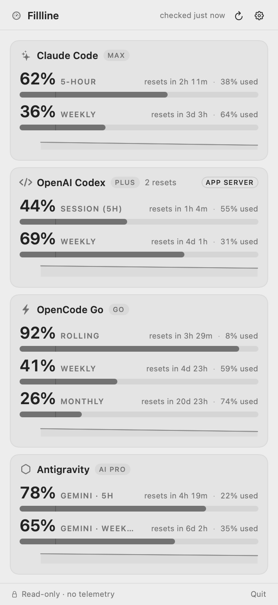
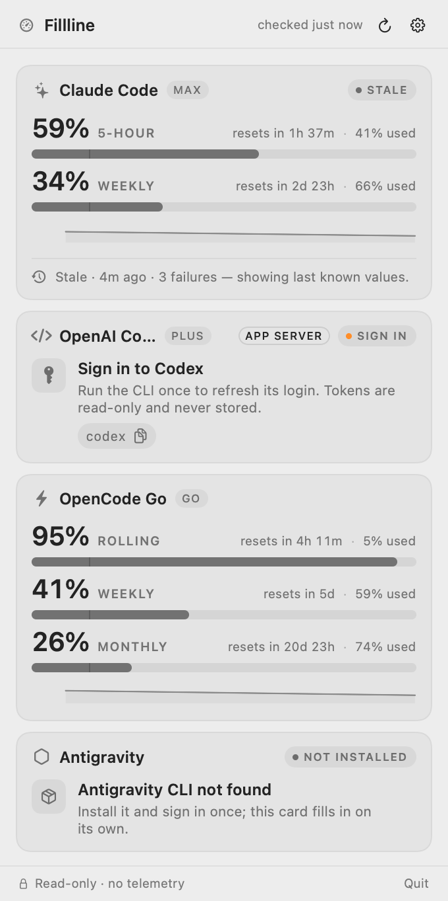

# Fillline

A macOS 14+ menu-bar app that shows how much of your AI coding quota is **left** — for
Claude Code, OpenAI Codex, OpenCode Go, Antigravity, GitHub Copilot and OpenRouter — and when
each limit resets. It reads the credentials your CLIs already stored, calls the same usage
sources those CLIs use, and renders remaining percentages. No login flow, no token refresh, no
telemetry, and no third-party dependencies.

<p align="center">
  <picture>
    <source media="(prefers-color-scheme: dark)" srcset="docs/marketing/assets/app-popover-healthy-dark.png">
    
  </picture>
</p>

These are rendered from the shipping SwiftUI views (`./Scripts/screenshots.sh`, `ImageRenderer`), not
mockups — same layout, same numbers formatting. The second pair shows what failure looks like, which
is the part most quota apps get wrong:

<p align="center">
  <picture>
    <source media="(prefers-color-scheme: dark)" srcset="docs/marketing/assets/app-popover-degraded-dark.png">
    
  </picture>
</p>

## Features

- **Remaining-% first.** The menu bar shows one number per provider (`C 62% · O 40%`);
  used-% is secondary detail in the popover.
- **5-hour session + weekly (7-day) windows** for Claude Code and Codex, each with a reset
  countdown. Claude Code's additional scoped windows are shown when present.
- **Rolling (5h) + weekly + monthly windows** for OpenCode Go.
- **Monthly AI-credit allowance** for GitHub Copilot, and a **USD credit balance** for
  OpenRouter — shown as an amount (`$8.50 left`), never as an invented percentage.
- **Honest staleness.** When a refresh fails the card keeps the last known-good value and
  labels it `stale · 4m ago`. Values are never fabricated, and never silently reset to 0%.
- **Independent per-provider failure isolation.** One provider being down, rate-limited,
  or logged out does not affect the other cards. States are explicit: `ok`, `stale`,
  `needs login`, `rate limited`, `not installed`, `not subscribed`, `unsupported`, with the
  age of every value attached.
- **Read-only credentials, no refresh.** Tokens are read from where your CLIs put them,
  used in memory, and never written back. Refreshing a token would rotate it and break the
  CLI that owns it, so if a token is expired the card says `needs login` and asks you to run
  the CLI once.
- **Notifications** at 80% and 95% of a window, and shortly before a reset. Off by default;
  permission is only requested when you switch them on, and each window alerts once per reset cycle.
- **A seven-day trail per card.** A quiet line shows where the number has been, on a fixed
  `0…1` scale so a small wobble can never be drawn as a cliff. Hidden until there are two samples.
- **Provenance, not just numbers.** When Codex answers over its documented `app-server` interface
  the card says so; the internal HTTP fallback is badged differently. Reset credits appear as
  `N resets`.

## How it gets your numbers

All three providers report a **0–100 "used"** value (`percent` or `utilization`). The app
computes remaining as `100 − used` and never displays the raw provider number as if it were
remaining.

| Provider | Primary source | Credential (read-only) | Notes |
|---|---|---|---|
| **Claude Code** | `GET https://api.anthropic.com/api/oauth/usage` with `anthropic-beta: oauth-2025-04-20` and a required `User-Agent: claude-code/*` header | OAuth access token from the Keychain item `Claude Code-credentials` | Never written back, never refreshed. Missing/blocked `User-Agent` triggers a 429 storm. Polled at most every **180 s**; exponential backoff on 429. Fallback is local aggregation of `~/.claude/projects/**/*.jsonl`, labelled `estimated`. |
| **OpenAI Codex** | `codex app-server` JSON-RPC `account/rateLimits/read` (documented local interface) — *wired in Phase 2; until then the app uses the HTTP path below* | `~/.codex/auth.json`, handed to the CLI — the app never rewrites it | Fallback: `GET https://chatgpt.com/backend-api/wham/usage` with the token from `~/.codex/auth.json`. Last resort: `rate_limits` blocks in `~/.codex/sessions/**/*.jsonl`. Reset times are **epoch seconds**. Codex not installed → `not installed` card. |
| **OpenCode Go** | `GET https://opencode.ai/zen/go/v1/usage` with a Bearer `oc_sk_…` key | `~/.config/opencode/.secrets/opencode-key`, or `$OPENCODE_API_KEY` (env wins) | Returns `rolling` (5h), `weekly`, and `monthly` windows; `percent` is 0–100 *used*. HTTP 403 means no active subscription → `not subscribed`, not an error. |

| **GitHub Copilot** | `GET https://api.github.com/copilot_internal/user` (internal) | token from `gh auth token` — read-only, never stored | `percent_remaining` is 0–100 **remaining**, the third unit convention in this app; `unlimited` and zero-entitlement buckets are labelled, never 0%. |
| **OpenRouter** | `GET https://openrouter.ai/api/v1/key` | `$OPENROUTER_API_KEY`, the OpenCode auth file, or a key you paste into Settings | No percentages: only USD amounts, rendered as text rows. Account balance needs a management key, so only the per-key budget is shown. |

Every provider uses a `primary → fallback → cached` ladder, and each has its own
`Endpoints.swift` holding the URLs, headers, and parsing keys — so breakage is a one-file
fix, and the parsers are deliberately *not* shared (the three reset-time formats differ:
ISO-8601 with fractional seconds, ISO-8601 with milliseconds, epoch seconds).

## Unofficial, and what that means

**Two of the three primary paths are undocumented internal APIs**: Anthropic's
`/api/oauth/usage` and OpenCode's `/zen/go/v1/usage`. Neither is a public or stable
contract; they can change shape, change auth requirements, or disappear without notice,
including in a CLI auto-update. This project keeps up on a best-effort basis and nothing
here is guaranteed.

Codex is the exception: its `app-server` JSON-RPC interface is documented and is therefore
the preferred source. The `chatgpt.com/backend-api/wham/usage` fallback is not documented.

Anthropic's documentation states that developers may not collect, store, or intermediate
Claude.ai credentials. We take that seriously: the Claude Code usage-endpoint path is
**opt-in**, the OAuth token is read only when you enable it, and it is held **in memory
only** — never persisted, never attached to logs, never sent anywhere except
`api.anthropic.com`. Without opting in, the Claude Code card uses local log aggregation
instead. See <https://code.claude.com/docs/en/legal-and-compliance>.

Using undocumented endpoints may conflict with a provider's terms of service, and accounts
have been rate-limited or flagged for automated polling. **There is no warranty of any
kind. Use at your own risk.** Each provider can be disabled independently.

Out of scope by policy: **Gemini CLI**. Its individual-user OAuth path was retired in June
2026 and using it would require reusing a first-party client secret. It is not implemented
and not planned.

## Privacy

- **No telemetry, no analytics, no crash-report uploads.** The app has no server.
- **Network is restricted to a compiled-in domain allowlist:** `api.anthropic.com`,
  `chatgpt.com`, `opencode.ai`. A CI guard fails the build if any other URL literal appears
  under `Sources/`. Redirects to other hosts are refused.
- **Tokens are never logged.** Sensitive values go through a `Redacted` wrapper and are
  emitted with `os.Logger` privacy `.private`.
- **No disk copies of tokens.** They are read from the Keychain / CLI config on demand, kept
  in memory, and discarded. The app never writes to `~/.claude`, `~/.codex`, or
  `~/.config/opencode`, and it never refreshes a token — that would rotate the credential
  and break the CLI that owns it.
- **Local history is percentages only.** To draw the seven-day trail the app keeps
  `~/Library/Application Support/Fillline/history.json`: provider, window, timestamp, and the
  used fraction. No prompts, no responses, no account identifiers. It is pruned to 7 days and
  you can delete the file at any time; it is never uploaded.
- **Not sandboxed, and not on the Mac App Store.** Reading `~/.claude`, `~/.codex`, and
  pre-existing Keychain items requires it, so the app ships outside the App Store (Developer
  ID signed, notarized DMG). That trade-off is documented on purpose — review the source
  before trusting it with a credential file.

## Install

Planned for v1, not yet released:

- **DMG** — universal (arm64 + x86_64), Developer ID signed and notarized, from
  [GitHub Releases](../../releases).
- **Homebrew** — `brew install --cask Fillline` *(coming in v1)*.

Requires macOS 14 Sonoma or later. You need at least one of the CLIs installed and logged
in; this app does not provide its own login.

## Build from source

The core library builds with Command Line Tools alone. The app bundle needs a full Xcode
install (and XcodeGen).

```bash
# Core library + tests — works with Command Line Tools only
swift build
swift test

# App bundle — requires Xcode
brew install xcodegen
xcodegen generate
xcodebuild -scheme Fillline -configuration Debug build
open build/Build/Products/Debug/Fillline.app
```

`.xcodeproj` is generated and never committed; `project.yml` is the source of truth.
`Scripts/build.sh` wraps the commands above. `Scripts/release.sh` does the signed,
notarized universal release and needs your own Developer ID — no identities are committed.

## Roadmap

- [x] **Phase 0 — validation spike.** Real captures for Claude Code and OpenCode Go
  (masked, in `docs/providers/`); Codex contract documented, live capture pending CLI
  install; OpenCode Go confirmed as the third provider (Gemini CLI excluded); Keychain
  access works, but ad-hoc signing re-prompts every build, so releases need a stable
  Developer ID.
- [ ] **Phase 1 — MVP.** `UsageCore` for all three providers with cache and backoff, all
  green under `swift test`. `MenuBarExtra` label and popover, manual refresh, settings
  (poll interval, which window to show), `not installed` / `needs login` cards, and the
  Claude OAuth read opt-in (off by default).
- [ ] **Phase 2 — reliability & UX.** Codex `app-server` strategy hardening,
  80%/95% notifications, refined stale labelling, first-run onboarding, snapshot history
  for sparklines.
- [ ] **Phase 3 — distribution.** Developer ID signing + notarization, DMG, Homebrew cask,
  README screenshots, GitHub Actions release workflow.
- [x] **Phase 4 — more providers.** Antigravity (opt-in), GitHub Copilot, OpenRouter.
  Still optional: a cost-conversion view, Windows support (see issue #11).

## Naming and trademarks

This project is **not affiliated with, endorsed by, or sponsored by** Anthropic, OpenAI, or
OpenCode. "Claude", "Codex", and "OpenCode" are trademarks of their respective owners and
are used here only to describe which tool a number comes from. `Fillline` is a working
name, and the product name deliberately avoids those marks.

## License

MIT — see [LICENSE](LICENSE). Contributions are accepted under the same license; see
[CONTRIBUTING.md](CONTRIBUTING.md) and [SECURITY.md](SECURITY.md).
